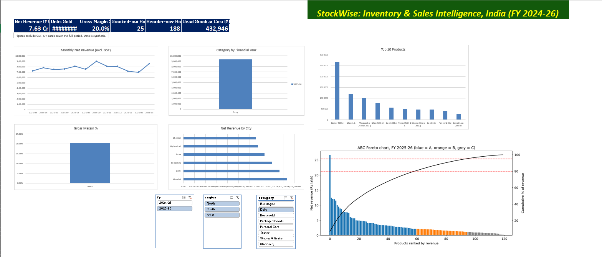
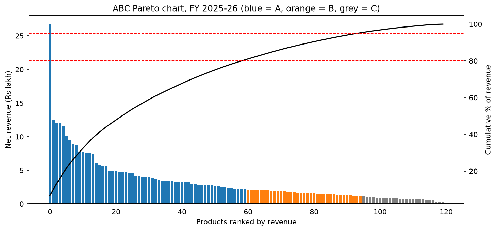
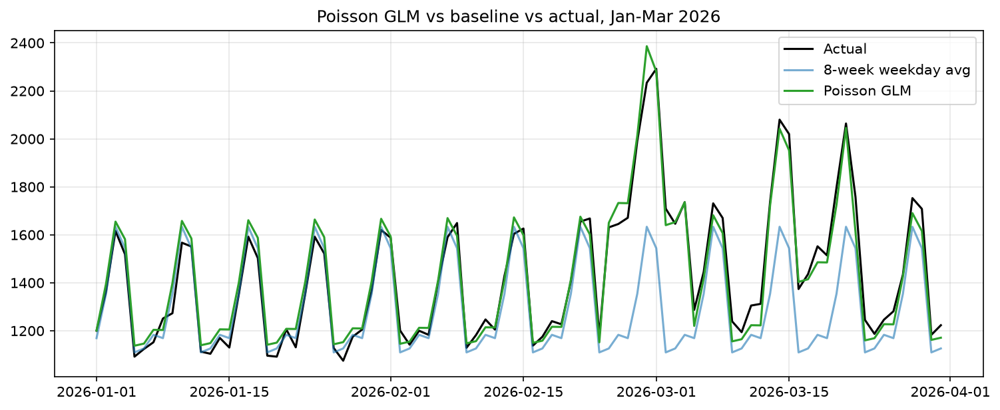
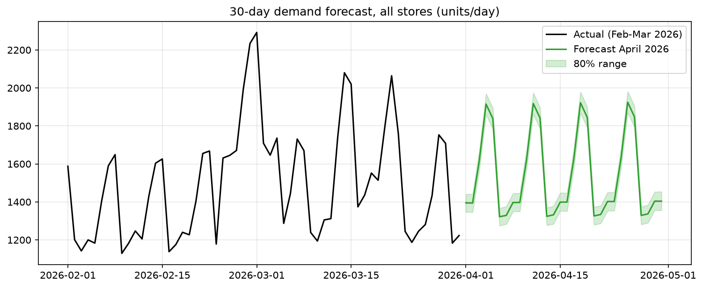
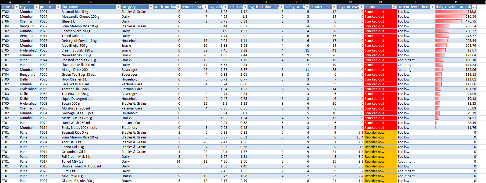

# StockWise: Inventory & Sales Intelligence (India)

An end-to-end retail analytics and demand-forecasting project built with **Python, SQL and Excel**.
It answers three business questions for an Indian retail chain: **what sells, what is about to run out, and what is sitting idle.**
It then forecasts demand and turns the forecast into reorder recommendations.

> **Data is synthetic.** Brands, suppliers and stores are fictional. GST rates are illustrative, so check the current official rate for every product before real use.
> The column structure follows a typical Indian retail export, so a company can load its own CSVs with the same columns.



## Dataset

| Item | Value |
| --- | --- |
| Period | 2024-04-01 to 2026-03-31 (FY 2024-25 and FY 2025-26, April to March) |
| Sales lines | 346,107 across 83,562 invoices |
| Stores / products / suppliers | 6 / 120 / 10 |
| Stores | Pune, Mumbai, Delhi, Bengaluru, Hyderabad, Chennai |
| Inventory | Snapshot of stock per store and product on 2026-03-31 |
| Currency | Indian rupees. MRP and selling price include GST |

**Indian retail conventions used:** MRP is the price ceiling and includes GST, so net revenue is `selling_price / (1 + GST%)`. Margins and ABC ranking use net revenue. The financial year runs April to March. UPI is the most common payment mode. Festival demand spikes (Diwali, Holi, Eid) and a summer beverage peak are built into the data.

## Key results

| Metric | Value |
| --- | --- |
| Net revenue (excl. GST) | Rs 7,63,16,644 |
| Gross sales (incl. GST) | Rs 8,35,97,002 |
| Gross profit | Rs 1,52,68,674 (20.0% margin) |
| Units sold | 1,012,467 |
| FY 2025-26 vs FY 2024-25 net revenue | +6.3% |
| Store-product rows stocked out | 25 of 720 |
| Rows flagged "Reorder now" | 188 of 720 |
| Net revenue lost per day from stocked-out rows | Rs 4,789 |
| Dead-stock products | 8, with Rs 4,32,946 of capital locked (at cost) |
| Inventory turnover (overall, approximate) | 11.7x per year |

### ABC analysis (FY 2025-26, by net revenue)

| abc_class | SKUs | % of SKUs | % of revenue |
| --- | --- | --- | --- |
| A | 60 | 50.0 | 80.5 |
| B | 35 | 29.2 | 14.8 |
| C | 25 | 20.8 | 4.7 |



### Reorder status (95% service level)

| status | rows |
| --- | --- |
| OK | 459 |
| Reorder now | 188 |
| No recent demand | 48 |
| Stocked out | 25 |

### How the current reorder levels compare with calculated reorder points

| current_level_check | rows |
| --- | --- |
| Too low | 548 |
| About right | 124 |
| n/a (no demand) | 48 |

### Dead stock (no sale anywhere for 60+ days)

| product_id | sku_name | category | days_since_last_sale | units_in_stock | stock_value_cost |
| --- | --- | --- | --- | --- | --- |
| P060 | Rose Syrup 750 ml | Beverages | 90 | 1228 | 113750.0 |
| P024 | Ghee 500 ml | Dairy | 90 | 458 | 110470.0 |
| P069 | Sunscreen 50 g | Personal Care | 90 | 471 | 107638.0 |
| P092 | Mixed Fruit Jam 500 g | Packaged Foods | 90 | 252 | 28032.0 |
| P009 | Sugar 1 kg | Staples & Grains | 90 | 629 | 24531.0 |
| P079 | Dishwash Bar 3 pack | Household | 90 | 553 | 21440.0 |
| P097 | Oats 1 kg | Packaged Foods | 90 | 98 | 15595.0 |
| P005 | Moong Dal 1 kg | Staples & Grains | 90 | 96 | 11490.0 |

### Inventory turnover by category

| category | turnover_x | days_of_inventory |
| --- | --- | --- |
| Beverages | 11.4 | 32.0 |
| Dairy | 15.4 | 24.0 |
| Household | 11.1 | 33.0 |
| Packaged Foods | 9.8 | 37.0 |
| Personal Care | 9.6 | 38.0 |
| Snacks | 11.2 | 33.0 |
| Staples & Grains | 10.0 | 36.0 |
| Stationery | 20.2 | 18.0 |
| TOTAL | 11.7 | 31.0 |

## Demand forecasting

Models were tested on the final 90 days (Jan to Mar 2026), trained only on earlier data (a time split, never random). The 8 dead-stock products were excluded because their demand stopped for a stock reason, not a demand pattern.

| model | MAE (units/day) | WAPE % | Bias % |
| --- | --- | --- | --- |
| Poisson GLM | 44.4 | 3.1 | 0.2 |
| 8-week weekday average | 140.6 | 9.8 | -8.8 |
| Repeat last week | 142.6 | 10.0 | -8.2 |

WAPE = total absolute error / total actual units. Bias below zero means under-forecasting. The Poisson GLM uses weekday, yearly trend, a summer flag and festival flags. The best model by WAPE is **Poisson GLM** at 3.1%.



**Per-category backtest** (one model per category):

| category | WAPE % | Bias % |
| --- | --- | --- |
| Beverages | 14.4 | -1.2 |
| Dairy | 4.1 | 0.3 |
| Household | 7.0 | 0.6 |
| Packaged Foods | 8.6 | 0.3 |
| Personal Care | 9.8 | -1.9 |
| Snacks | 3.8 | 0.8 |
| Staples & Grains | 6.0 | 0.0 |
| Stationery | 10.7 | 6.1 |

**30-day forecast (April 2026), all stores:** about **46,169 units**, with an 80% range per day in `data/forecast_next30.csv`.



### From forecast to orders

Each category's April uplift (forecast April average / actual Jan-Mar average) scales every store-product's recent demand:

| category | jan_mar_avg | april_forecast_avg | uplift |
| --- | --- | --- | --- |
| Beverages | 246.6 | 347.9 | 1.41 |
| Dairy | 308.8 | 287.3 | 0.93 |
| Household | 85.4 | 87.8 | 1.03 |
| Packaged Foods | 93.0 | 86.0 | 0.92 |
| Personal Care | 68.2 | 68.1 | 1.0 |
| Snacks | 432.0 | 407.1 | 0.94 |
| Staples & Grains | 141.2 | 137.0 | 0.97 |
| Stationery | 54.1 | 115.8 | 2.14 |

Target stock = forecast daily demand x (lead time + 7-day review period) + safety stock. Order quantity = target stock - stock on hand, never below zero.
Result: **378 of 720 store-product rows** get an order, with a total order value of **Rs 3,62,963** at cost (`data/order_recommendations.csv`).

## Excel dashboard

Pivot tables, KPI cards, charts and slicers (financial year, region, category) built in `excel/StockWise_Dashboard.xlsx`. A conditional-formatted **Reorder_Alert** sheet shows stocked-out and reorder-now rows sorted by revenue at risk. All dashboard totals were reconciled against SQL.



## Project structure

StockWise/
├── data/ generated CSVs and analysis outputs
├── sql/ schema.sql, validation.sql, analysis_queries.sql
├── scripts/ 01-06: generate data, load database, export Excel, build README
├── notebooks/ 01_cleaning_eda, 02_analytics, 03_forecasting
├── excel/ StockWise_Dashboard.xlsx
├── images/ charts and screenshots
└── README.md

## How to run

```bash
python -m venv venv
venv\Scripts\activate
pip install -r requirements.txt
python scripts/01_generate_master_data.py
python scripts/02_generate_sales.py
python scripts/03_generate_inventory.py
python scripts/04_load_database.py
python scripts/run_sql.py sql/validation.sql
```

Then run the three notebooks in order, then `python scripts/05_export_excel.py` and `python scripts/06_build_readme.py`.

## To use it with a real company's data

Replace the CSVs in `data/` (suppliers, stores, products, sales, inventory) with exports in the same columns, keep the real GST rate per product, and replace the festival windows in the forecasting notebook with the company's own calendar. Then re-run the pipeline.

## Assumptions and limitations

- **Synthetic data.** Patterns were planted (festivals, summer beverages, weekday effect, 8 dead-stock products), and the analysis recovers them. Real data will be messier.
- **Festival flags use the same windows used to generate the data**, so the forecast test is more flattering than real data would give. Only Diwali, Holi and Eid are modelled, and each is learned from one or two occurrences.
- **Category margin differences are random noise** from the data generator and are not a finding.
- **Inventory turnover is approximate**: it uses one stock snapshot, not average inventory over the year.
- **Safety stock formula** assumes fixed lead time and independent daily demand. Z = 1.645 targets a 95% service level. The 90-day window includes the Holi/Eid spike, so reorder points and the "Reorder now" count are somewhat high.
- The "too low / too high" thresholds for current reorder levels (below 80% or above 125% of the calculated point) are a judgment call.
- The forecast range reflects day-to-day randomness only, not uncertainty in the fitted coefficients. The yearly trend is extrapolated.
- Order recommendations ignore supplier minimum order quantities and pack sizes, and use an assumed 7-day review period. They are for a manager to review, not automatic purchasing.
- `invoice_id` grouping is synthetic.
- **ABC concentration is moderate**: about half of SKUs make up class A. This reflects the synthetic demand mix and shouldn't be read as a general retail finding.
- **The "too low" reorder-level count is partly built into the data**: the generated levels exclude safety stock while the calculated reorder points include it.
- **The forecast model has no month-specific category effects** (only a summer flag), so Beverages and Stationery are forecast less accurately than other categories.

## Tools

Python (pandas, NumPy, statsmodels, matplotlib), SQL (SQLite, CTEs, window functions, views), Excel (PivotTables, slicers, conditional formatting), Git/GitHub.
